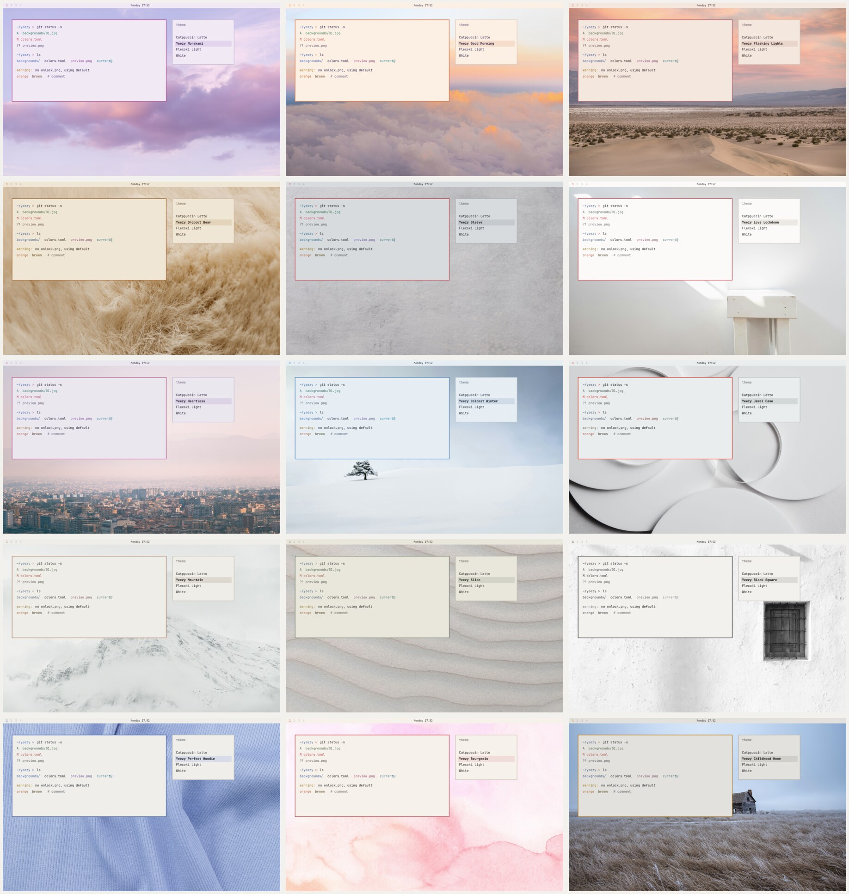

# Yeezy themes for Omarchy

Fifteen light themes for [Omarchy](https://omarchy.org), each taken from one object, image or room from a Kanye West era. All are soft: charcoal instead of black, washed colour instead of saturated, quiet wallpapers.



| Era | Themes |
|---|---|
| Graduation (2007) | Murakami, Good Morning, Flashing Lights, Dropout Bear |
| 808s & Heartbreak (2008) | Sleeve, Love Lockdown, Heartless, Coldest Winter |
| Yeezus (2013) | Jewel Case, Mountain |
| Season (2015 on) | Slide |
| Donda (2021 to 2022) | Black Square, Perfect Hoodie, Bourgeois, Childhood Home |

## Install

```bash
git clone https://github.com/Faxulous/omarchy-yeezy.git
cd omarchy-yeezy
./install.sh
omarchy theme set "Yeezy Murakami"
```

`install.sh` copies every theme into `~/.config/omarchy/themes/`. Each theme ships three to five photographs and one drawn wallpaper at 3200x2000; cycle them with `omarchy theme bg next`.

## Rebuilding

Each theme is a `colors.toml`, an icon colour and a wallpaper folder. Omarchy generates everything else from the colours.

| Script | Does |
|---|---|
| `build.py` | Writes `colors.toml` and `icons.theme` for every theme from the palette table at the top of the file |
| `graphics.sh` | Draws the `9-graphic.jpg` wallpapers |
| `photos.sh` | Crops and grades the source photographs (needs the originals in `sources/`, which are not in the repo) |
| `previews.sh` | Draws `preview.png` for the theme picker |
| `credits.py` | Writes `CREDITS.md` |

To change a colour, edit the table in `build.py`, then run `./build.py && ./previews.sh && ./install.sh` and re-apply the theme.

## Credits

The photographs come from Unsplash, Pexels and Wikimedia Commons; see [CREDITS.md](CREDITS.md) for every photographer and source. No album artwork, video stills or product photography is included. This project is a fan work and is not affiliated with Kanye West, Yeezy or any label.

The scripts and colour files are MIT licensed. The photographs remain under their own licences.
